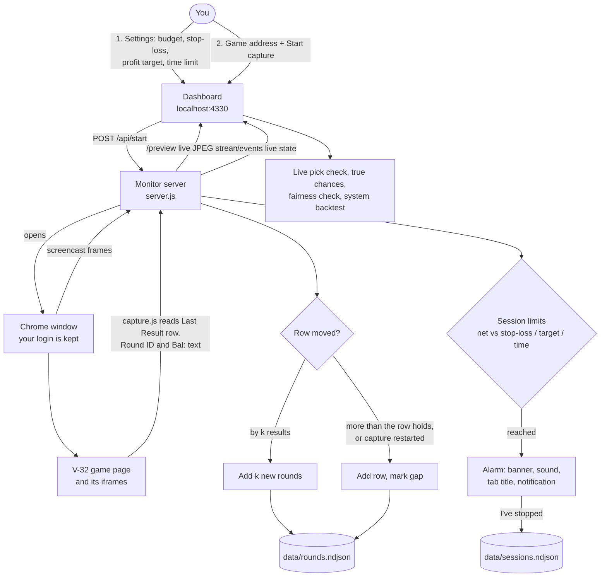

# V-32 Live Monitor

Watches a V-32 Cards table for you: it opens the game in its own Chrome window, reads each
finished round from the **Last Result** row, shows a live view of the game, and tracks your
playing session against the budget, stop-loss, profit target and time limit you set.

**It never bets in the game.** It reads results, odds and your balance. Its only actions are:
opening **VR 32 Cards (MAC88)** from the Virtual Games list (it types "32" in Search game and
clicks that tile), and clicking the game's own **Reconnect** button when the game shows
"Disconnection due to inactivity" (at most every 15 s and 20 times an hour). Both can be turned
off in Settings.

**It cannot predict the next winner.** Every round is a new shuffle of 32 cards, so past
results say nothing about the next one. The dashboard shows each player's real win chance
(Player 11 wins about 46.5% of rounds, Player 8 about 8%), checks your captured results against
it, and replays common "prediction systems" on your own history so you can see they land at
chance.

## Start it

Needs Node.js 18+ and Google Chrome (or Microsoft Edge).

```bash
cd v32-monitor
npm install      # first time only
npm start        # opens http://localhost:4330
```

## Use it

1. The first time, **Settings** opens by itself. Enter:
   - **Budget:** the most money you are ready to spend this session.
   - **Stop-loss:** stop when you are down this much (no more than the budget).
   - **Profit target:** stop when you are up this much (0 = none).
   - **Time limit** in minutes (0 = none), and whether to sound an alarm.
   Change them any time with **⚙ Settings**.
2. Click **Start capture** with `https://d.broplay247.com/virtual-games`. A Chrome window opens;
   log in there once. The monitor then opens VR 32 Cards (MAC88) by itself. The live view on the right shows that window.
3. Click **Start session** before you play. It asks for your budget, stop-loss, profit target and
   time limit, and whether to start **practice autoplay** (pretend money) with it: method (Auto
   by default), stake, stake after a loss and a round limit. Your starting balance is read live
   from the game, with nothing to type; autoplay starts from the same balance and stops at the same
   limits. Ending the session stops autoplay. A brief "Bal: 0" while the game reloads is ignored.
4. When you reach a limit the monitor flashes a banner and the tab title, sounds an alarm and
   shows a desktop notification. Click anywhere on the page once so the browser allows sound,
   and allow notifications when asked. **I've stopped – end session** saves the session under
   **Past sessions**.

The monitor never fills in the login or password box: log in yourself in its Chrome window
(Virtual Game → V-32 Cards). The window keeps your sign-in, so you only do this once. Start capture
with the Virtual Games page (`https://broplay247.com/virtual-games`) and click V-32 Cards there:
opening the table's address directly logs you out on Broplay. **Show game window** brings the
monitor's window to the front.

**Staying signed in:** every 40 seconds the monitor moves the pointer by one pixel in the corner of
the game window, so the site doesn't sign you out for inactivity (it never clicks or types for this). If the game still disconnects for inactivity, the monitor
clicks that dialog's Reconnect button for you. If no
new round arrives for 2.5 minutes, the status turns red ("No new rounds – check the game"), it
beeps and shows a notification, so you can log back in or reopen the table.

**Win % overlay:** on the live view (minimise or maximise it with its buttons), each player's true chance, their share of the last 20
captured rounds, the change from the true chance in points, and an arrow for which way the share
moved with the latest round, the live pick check (next pick, last round hit or miss, hit rate)
and, while autoplay runs, its next pretend bet and balance. Turn it off with the checkbox. In a narrow window it sits under the
picture.

**Live balance:** the header shows your game balance as it changes (it flashes green or red) and
the change since capture started. It's also on the overlay.

**Auto-click in game (number and amount):** can automatically click the player number (Player 8, 9, 10, or 11) and bet amount (chip or stake input) in the game window when each round opens.
- **Number:** choose a fixed player or "Auto" to follow the live prediction/autoplay pick (by default Player 11, the highest win-rate player).
- **Amount:** choose a fixed stake (or chip denomination) or "Auto" to follow your practice stake and martingale progression.
- **Safety checks:** automatically pauses if your session stop-loss or profit target is reached, if your game balance is lower than the stake, or if capture goes stale. It never double-clicks within the same round.
- **Test click:** click **⚡ Click now (Test)** on the dashboard to test clicking the number and amount in the game window at any time.

**Predicted vs real result:** 15 prediction methods (always one player, repeat last, hottest,
coldest/"due", same as 2 rounds ago, switch, and "what came after the last 1, 2 or 3 results")
are scored on every captured round, each picking only from earlier rounds. For each it shows
same/different, win rate, the rate expected by chance, the normal-luck range for that many
rounds, and the money result of ₹100 on every pick at the Back odds read from the table. The latest rounds
are listed with the prediction next to the real result.

**Model lab:** trained prediction models (learned frequency, recent form, sequence models over
the last 1, 2 and 3 results, a streak model and an ensemble) are trained walk-forward only on the
rounds captured from your game, retraining every round. Each is scored against the exact 32-card model: win rate, the difference
with a z-score, log score, money on its pick, and "value bets". A model only counts as having an
edge if it stays clearly ahead (z above 2.5) over many rounds; on a fair game none does.


## How it works



The monitor never sends clicks or key presses to the game: the only path into the game page is
`capture.js`, which reads text.

## Where things are kept

Everything stays on your computer, in `data/`: `rounds.ndjson` (every captured round),
`settings.json`, `session.json` and `sessions.ndjson`. **Download CSV** exports the rounds.
The game window's sign-in is kept in `browser-profile/`.

## How results are read

The monitor looks in every frame of the game window for a row of at least five entries that
are all 8, 9, 10 or 11, preferring one next to a "Last Result" heading. When the row changes it
works out how far it moved and records only the new results. Which end of the row is newest is
found automatically (or set it in Settings). If more rounds passed than the row holds (for
example the window was asleep), the whole row is added and marked as a gap.

## Tests

```bash
npm test
```

- `tests/monitor.test.js`: rules and true chances, reading new results from the row (both
  directions), gaps, resuming after a restart, settings, limits, the session and alarm through
  the HTTP API, and that other websites can't drive the monitor.
- `tests/e2e.test.js`: opens the demo table in a real headless Chrome and checks that every round
  is captured in order, that bursts of rounds are caught, that more rounds than the row holds
  are flagged as a gap, the balance, session and stop-loss alarm, the live view, and that a
  restart is marked as a gap. Skipped when Chrome or Edge isn't installed.
